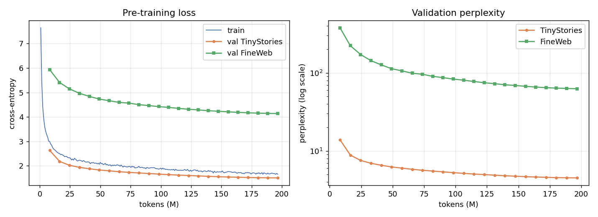
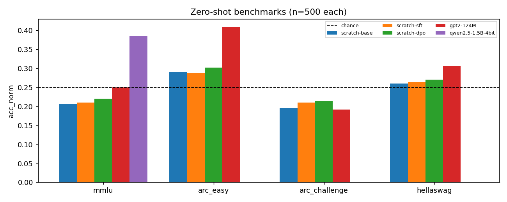

# LLM From Scratch + Post-Training + Agentic RAG

A decoder-only language model implemented, pre-trained, aligned and served from scratch, then used inside a retrieval-augmented agent. A QLoRA fine-tune of Qwen2.5-1.5B on the same data is included for comparison.

Trained weights: [ahmedashrafk12/llm-scratch-37m](https://huggingface.co/ahmedashrafk12/llm-scratch-37m) (`base/`, `sft/`, `dpo/`, `qlora/` adapter). Every number below was measured on a Colab T4 and is reproduced in [results/TABLES.md](results/TABLES.md).

## Why
Most portfolios call an LLM API or fine-tune a downloaded model. This repo covers the layers underneath: how a Transformer is built, trained and aligned, and how retrieval changes its behaviour.

## What is built
| Area | Location | What it covers |
|---|---|---|
| Tokenizer | `tokenizer/` | Byte-level BPE from scratch: regex pre-tokenization, incremental pair counting, special tokens, exact round-trip, and a comparison with GPT-2 |
| Model | `model/` | Token embeddings, **RoPE**, **Grouped-Query Attention** (8 query heads / 2 KV heads), a fused SDPA kernel (FlashAttention-2 on Ampere+, memory-efficient kernel on Turing), **SwiGLU**, **RMSNorm**, tied embeddings and a KV-cached sampler. About 37M parameters. |
| Data | `data/` | TinyStories plus deduplicated FineWeb. Quality filters (Gopher/C4-style), exact dedup and MinHash-LSH near-dedup. Packed uint16 token streams. |
| Pre-training | `training/pretrain.py` | AdamW, warmup + cosine schedule, gradient clipping and accumulation, fp16 AMP, gradient checkpointing, and checkpoint save/resume locally and to the **Hugging Face Hub** |
| SFT | `training/sft.py` | Prompt-masked instruction tuning on Dolly plus domain QA pairs built for this project (closed-book and open-book formats) |
| DPO | `training/dpo.py` | Direct Preference Optimization against a frozen SFT reference, with on-policy rejected answers |
| RM / PPO | `training/reward_model.py` | A Bradley-Terry reward model. PPO is documented as the comparison. |
| QLoRA | `training/qlora.py` | Qwen2.5-1.5B in 4-bit NF4 with double quantization, LoRA r=16 on all projections, gradient checkpointing and paged 8-bit AdamW |
| Agentic RAG | `rag/` | Chunking, BGE/E5 embeddings, FAISS, BM25, hybrid RRF, a BGE cross-encoder reranker, tools (calculator, document search, lookup) and **self-correcting re-retrieval** with abstention |
| Evaluation | `evaluation/` | Perplexity; MMLU / ARC / HellaSwag versus GPT-2; Recall@k and MRR; RAGAS-style faithfulness, answer relevancy and context precision; hallucination rate on a hand-built set |
| Serving | `serve/` | FastAPI with SSE token streaming, a Gradio demo and a Dockerfile |

## Experiments
- Base vs SFT vs SFT+DPO.
- QLoRA 1.5B vs the from-scratch 37M model on identical tasks.
- RAG only vs fine-tune only vs RAG + fine-tune.
- Ablations: chunk size and overlap, top-k, reranker on/off, retriever mode, embedder, and self-correction on/off.

## Results

### Pre-training
37.4M parameters, 12,000 steps, 197M tokens, about 26.7k tokens/s on a T4.

| validation set | loss | perplexity |
|---|---|---|
| TinyStories | 1.516 | 4.55 |
| FineWeb | 4.128 | 62.1 |



The custom BPE tokenizer compresses TinyStories better than GPT-2 (4.17 vs 3.99 bytes/token) and FineWeb worse (3.71 vs 4.49). It was trained mostly on simple stories, so this is expected. Round-trip is exact on both.

### Post-training
| stage | measurement | result |
|---|---|---|
| SFT | val loss on SFT data (base → SFT) | 3.68 → 3.31 |
| DPO | held-out preference accuracy (SFT reference → DPO) | 0.50 → 0.90, margin 2.30 |
| Reward model | held-out pairwise accuracy after 3 epochs | 0.873 |

### Zero-shot benchmarks (acc_norm, n=500 per task, chance = 0.25)
| model | MMLU | ARC-Easy | ARC-Challenge | HellaSwag |
|---|---|---|---|---|
| scratch-base 37M | 0.206 | 0.290 | 0.196 | 0.260 |
| scratch-SFT | 0.210 | 0.288 | 0.210 | 0.264 |
| scratch-DPO | 0.220 | 0.302 | 0.214 | 0.270 |
| GPT-2 124M | 0.250 | 0.410 | 0.192 | 0.306 |
| Qwen2.5-1.5B (4-bit) | 0.386 | – | – | – |



The 37M model sits at chance on MMLU, ARC-Challenge and HellaSwag, which is normal at this size and token budget. Its ARC-Easy score is above chance but below GPT-2, which saw about 50x more tokens. Only MMLU was run for Qwen.

### Retrieval (252 queries)
| retriever (chunk 128 / overlap 32) | Recall@1 | Recall@5 | MRR@10 | ms/query |
|---|---|---|---|---|
| dense (BGE-small) | 0.413 | 0.603 | 0.489 | 16 |
| sparse (BM25) | **0.508** | 0.615 | **0.556** | 7 |
| hybrid (RRF) | 0.484 | 0.635 | 0.550 | 21 |
| hybrid + reranker | 0.393 | 0.615 | 0.488 | 1259 |

- BM25 is the strongest single retriever on this corpus, because the questions reuse its exact wording.
- The cross-encoder reranker **lowers** Recall@1 for every retriever and costs about 60x the latency.
- Larger chunks help: 256 words with 32 overlap gives MRR 0.537, compared with 0.488 at 128 words and 0.482 at 64 words.
- E5-small beats BGE-small for dense retrieval (MRR 0.552 vs 0.489).

### Question answering (n=200)
| system | exact match | contains gold |
|---|---|---|
| scratch-SFT, closed-book | 0.350 | 0.365 |
| scratch-SFT + RAG | **0.380** | 0.395 |
| scratch-DPO + RAG | 0.270 | 0.290 |
| Qwen base, no RAG | 0.000 | 0.095 |
| Qwen base + RAG | 0.000 | 0.205 |
| Qwen QLoRA, no RAG | 0.000 | 0.480 |
| Qwen QLoRA + RAG | 0.000 | **0.665** |

Qwen answers in full sentences, so exact match is always 0. For Qwen, "contains gold" is the meaningful number. For this model, fine-tuning helped more than retrieval (0.095 → 0.480 vs 0.095 → 0.205), and the two combine (0.665).

**Agent ablations (Qwen QLoRA + RAG):** top-k 1/3/5 gives contains-gold 0.585/0.665/0.670. Turning the reranker off scores slightly *higher* (0.680), which matches the retrieval ablation.

**Hallucination (18 unanswerable + 40 answerable questions):** RAG lowers the overall hallucination rate (QLoRA 0.93 → 0.71). However, no configuration abstained on unanswerable questions except the one without self-correction (0.83 answered). The abstention behaviour does not work at this model size.

### Known limitations
- **Faithfulness scores are close to 0 for every system.** The offline NLI judge rates most answer claims as "neutral" relative to the retrieved chunks. Spot checks show two causes: the gold fact is often not in the top-3 chunks (context precision is 0.34), and the NLI model is strict on short or ungrammatical claims. Use these numbers for comparing systems against each other, not as absolute faithfulness.
- The 37M model often loops or repeats itself on open-ended questions. Its QA scores come mostly from short yes/no answers.
- Each benchmark task uses 500 samples, so differences under about 0.04 are within noise.

## Run it
**On Colab (recommended):** open `colab_train.ipynb` on a T4 runtime and add `HF_TOKEN` as a Colab secret.

**Locally:**
```bash
pip install torch==2.5.1 --index-url https://download.pytorch.org/whl/cu121
pip install -r requirements.txt
python -m pytest tests -q
python data/prepare_pretrain.py && python tokenizer/train_tokenizer.py && python data/tokenize_corpus.py
python data/build_sft.py && python evaluation/build_hallucination_set.py
python training/pretrain.py --hub-repo <user>/llm-scratch-checkpoints   # add --resume after a disconnect
python training/sft.py && python training/dpo.py && python training/reward_model.py
python training/qlora.py
python evaluation/benchmarks.py && python evaluation/retrieval_eval.py && python evaluation/qa_eval.py
python evaluation/make_report.py
```
On Windows, import `datasets` before `torch`; the scripts already do this.

## Design notes
- **Evaluation is offline.** The `ragas` package needs an API judge, so its three metrics are recomputed with local judges (an NLI cross-encoder, BGE similarity and string-match relevance). `evaluation/rag_metrics.py` documents each substitution.
- **Agent control flow is deterministic.** A 37M model cannot emit reliable tool calls. A fixed policy also keeps every generator comparable on identical retrieval.
- **vLLM is not used locally.** vLLM does not run on native Windows, so local serving uses HF generate with a streamer. The API contract is identical.
